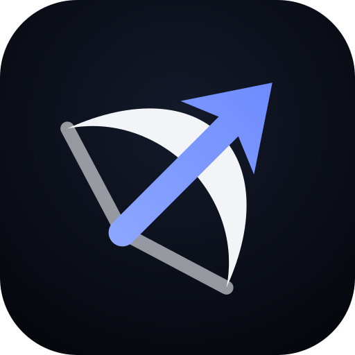
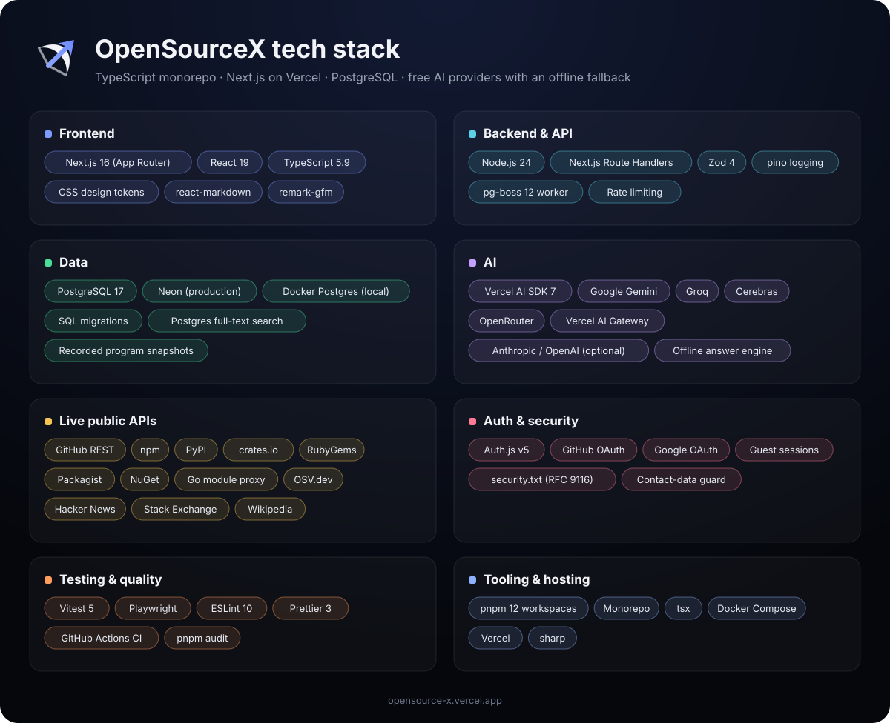

<div align="center">



# OpenSourceX

**Understand open source. Find where you belong.**

Programs, organizations, projects and repositories in one place, with an assistant that answers
any open source question and shows where every fact came from.

**[opensource-x.vercel.app](https://opensource-x.vercel.app)**

</div>

---

## What it does

- **Ask:** a chat assistant for everything open source, with chat history like ChatGPT or Claude.
  It knows how to apply to LFX Mentorship, GSoC and Outreachy (prerequisites, resumes, cover
  letters, proposals), finds organizations' repositories and Slack/Discord links, lists
  organizations that repeat across programs, and looks up live data: GitHub stars and good
  first issues, package versions, vulnerabilities, Stack Overflow answers and open source news.
- **Programs:** organizations, stipends, eligibility and timelines for Google Summer of Code, LFX
  Mentorship, Outreachy, Season of Docs, Summer of Bitcoin, European Summer of Code, OSPP, C4GT,
  MLH Fellowship, Igalia Coding Experience and Processing Foundation, taken from each program's
  official sources.
- **CNCF in LFX Mentorship:** every term from 2019 on, with the projects, mentors and timelines
  from the official CNCF mentoring repository.
- **Discover, projects, repositories and interview practice**, plus a saved workspace.
- **Help & support:** signed-in users report problems with optional screenshots, track them
  under My complaints, and can withdraw them. Staff answer from a private staff view.
- **Sign in** with GitHub or Google, or continue as a guest. A guest's chats move to their
  account when they sign in.

## Tech stack



| Layer               | What we use                                                                                                                                                                                                  |
| ------------------- | ------------------------------------------------------------------------------------------------------------------------------------------------------------------------------------------------------------ |
| Frontend            | Next.js 16 (App Router), React 19, TypeScript 5.9, CSS design tokens, react-markdown + remark-gfm                                                                                                            |
| Backend             | Node.js 24, Next.js Route Handlers, Zod 4, pino, pg-boss 12 background worker, rate limiting                                                                                                                 |
| Data                | PostgreSQL 17 (Neon in production, Docker locally), SQL migrations, Postgres full-text search for the knowledge base, committed program snapshots                                                            |
| AI                  | Vercel AI SDK 7 with Google Gemini, Groq, Cerebras and OpenRouter (free tiers), Vercel AI Gateway, optional Anthropic/OpenAI, and an offline answer engine when no model is available                        |
| Live public APIs    | GitHub REST, npm, PyPI, crates.io, RubyGems, Packagist, NuGet, Go module proxy, OSV.dev, Hacker News, Stack Exchange, Wikipedia (from the [public-apis](https://github.com/public-apis/public-apis) catalog) |
| Auth and security   | Auth.js v5 (GitHub and Google OAuth), guest sessions, RFC 9116 security.txt, contact-data guard                                                                                                              |
| Quality             | Vitest 5, Playwright, ESLint 10, Prettier 3, GitHub Actions CI, pnpm audit                                                                                                                                   |
| Tooling and hosting | pnpm 12 workspaces (monorepo), tsx, Docker Compose, Vercel, sharp                                                                                                                                            |

## How Ask answers

```
question ─► AI model (Gemini → Groq → Cerebras → OpenRouter → …) with read-only tools
              ├─ knowledge base   guides + reference proposals (Postgres full-text search)
              ├─ program data     organizations, repos, chat links, stipends, timelines
              ├─ LFX history      CNCF terms, projects, mentors
              └─ live APIs        GitHub, package registries, OSV, Stack Exchange, HN, Wikipedia
         └─► if no model is available or the free daily limit is reached:
             the offline engine answers from the same data
```

Links to organizations, repositories and chats only come from recorded data, never from a guess.
Free-tier caps (25 AI answers per user and 200 site-wide per day by default) keep it at zero cost.

## Architecture

```
Next.js app (UI + Route Handlers) ──► PostgreSQL ◄── Background worker (pg-boss)
        │                                ▲
        ├─► AI providers (AI SDK)         │
        └─► Live public APIs      Providers: GSoC, LFX, CNCF mentoring, program lists, GitHub
```

```
apps/web            Next.js UI, Route Handlers, Ask (lib/assistant), program data (data/)
apps/worker         background worker
packages/database   migrations, client, queries (chat history, knowledge base, saved items)
packages/shared     env, logger, errors, contact-data guard, metrics, AI budget guard
services/           providers, ingestion, entity-resolution
apps/web/data/      program snapshots, program info, knowledge-base guides
fixtures/           recorded, sanitized snapshots
tests/e2e           Playwright tests
docs/               product, architecture, data, security and design documents
```

## Getting started (development)

Prerequisites: Node 24, pnpm 12, Docker.

```bash
pnpm install
cp .env.example .env      # then fill in what you need; everything is optional locally
pnpm dev                  # database + migrations + recorded data + worker + web
pnpm db:knowledge         # load the Ask knowledge base
# open http://localhost:3001
```

Useful commands: `pnpm lint`, `pnpm typecheck`, `pnpm test`, `pnpm test:integration`,
`pnpm test:e2e`, `pnpm format:check`, `pnpm build`. Every setting is described in
[.env.example](.env.example). More in [docs/DEVELOPMENT.md](docs/DEVELOPMENT.md).

## Data and privacy principles

- Real, source-backed data only. Unknowns are shown as unknown, never guessed.
- Program data comes from each program's official public lists and pages (D-020).
- CNCF data covers CNCF projects only, not all of LFX Mentorship.
- Contact data (emails, LFIDs) is never ingested or exposed, and live API answers are stripped of
  email addresses.
- What the site stores and why: [Privacy Policy](https://opensource-x.vercel.app/privacy).
  Data rules: [docs/DATA_POLICY.md](docs/DATA_POLICY.md).

## Documentation

Start with [docs/PRODUCT_VISION.md](docs/PRODUCT_VISION.md) and [docs/PRD.md](docs/PRD.md),
then [docs/ARCHITECTURE.md](docs/ARCHITECTURE.md), [docs/DATA_SOURCES.md](docs/DATA_SOURCES.md)
and [docs/DATA_MODEL.md](docs/DATA_MODEL.md). Design:
[docs/DESIGN_SYSTEM.md](docs/DESIGN_SYSTEM.md). Decisions: [docs/DECISIONS.md](docs/DECISIONS.md).
Open items: [docs/OPEN_QUESTIONS.md](docs/OPEN_QUESTIONS.md).

## Security

Please report vulnerabilities privately. See [SECURITY.md](SECURITY.md) and
[opensource-x.vercel.app/security](https://opensource-x.vercel.app/security).

## License and reuse

OpenSourceX is a proprietary product. This repository is publicly visible but not licensed for
reuse or redistribution, and it does not accept external contributions. Third-party data
excerpts carry their own terms and attribution: [fixtures/ATTRIBUTION.md](fixtures/ATTRIBUTION.md).
CNCF mentoring content is used under CC BY 4.0.
